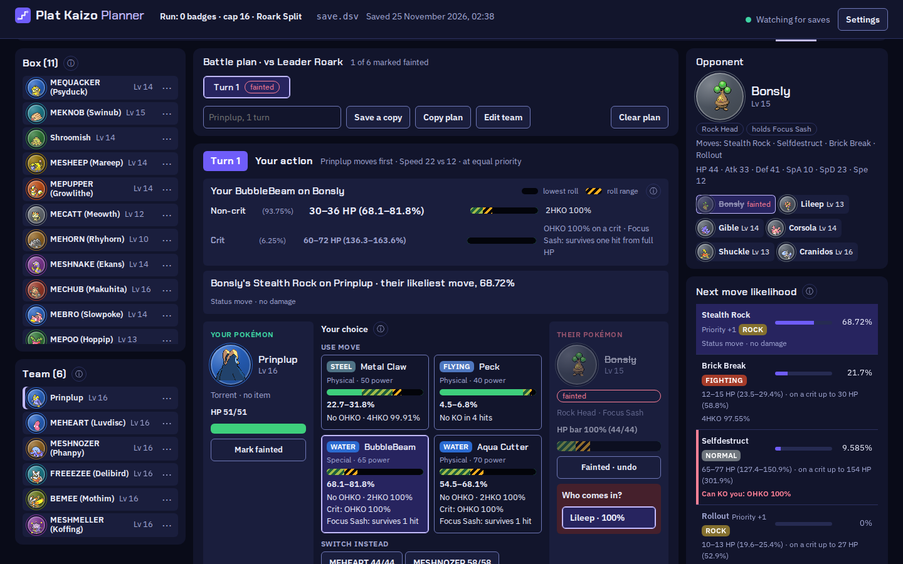
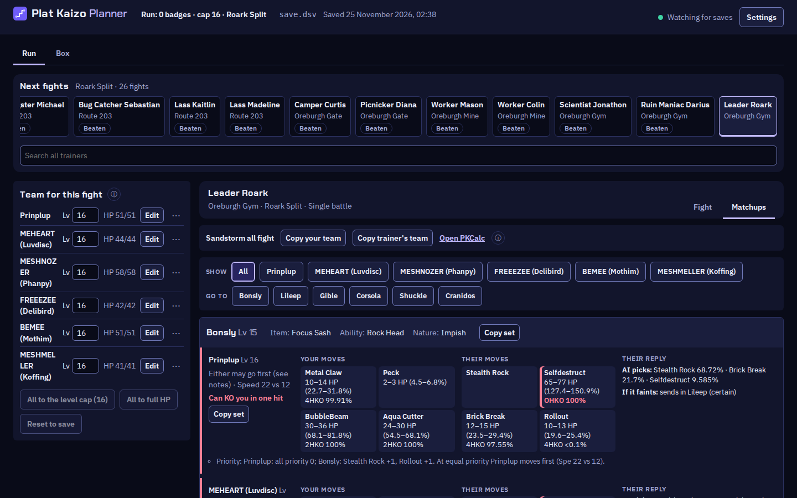

# Platinum Kaizo planner

[](https://github.com/Deriohig/kaizo-battle-planner/actions/workflows/ci.yml)

A battle planner for nuzlocke runs of Pokémon Platinum Kaizo, a difficulty hack of Pokémon Platinum. You load your
save, pick the next trainer and write the fight as a plan, one turn at a time. Each turn shows your moves' damage and
KO chances, the trainer AI's exact odds for its next move, and who it sends in when one of its Pokémon faints.

In a nuzlocke a Pokémon that faints is gone for good, and Kaizo trainers bring full teams with competitive sets. A line
that wins 95% of the time still ends the run one fight in twenty, so every probability the planner shows is exact.

Try it at [2-29-142-203.sslip.io](https://2-29-142-203.sslip.io) with your own DeSmuME save.





Both screenshots are from my own run, at the Oreburgh Gym fight against Roark.

## What it does

- Reads the game data from your ROM (species, moves, trainers, items and the trainer AI script) and your DeSmuME
  `.dsv` save (party, boxes, badges and level cap).
- Cross-checks the ROM against the hack's official docs (a Google Sheet) and against PKCalc, the community damage
  calculator for the hack. Every accepted difference is listed in `test/real/accepted-diffs.json` and explained in
  `docs/data-discrepancies.md`.
- Starts a draft team from the save that you can change without touching the save file: HP, status, held item, level,
  moves and order.
- The plan, one step per turn: who moves first, your moves' damage ranges with crits split out and KO chances, the
  AI's reply as exact odds, and who it sends in after a knockout. You set the field (weather, Trick Room, Stealth Rock,
  screens, status and stat stages), mark the trainer's Pokémon fainted as the fight goes, and save copies of a plan or
  copy it as text.
- A matchups view: each of your Pokémon against each of the trainer's, with damage both ways, speed order, the move the
  AI picks and who it sends in if its Pokémon faints.
- Lists the split's next fights in order, with a search over every trainer.
- Runs locally against your own files, or hosted with Docker, where each player loads their save in the browser.

## Why I built it

I play Platinum Kaizo as a nuzlocke. Planning a gym fight meant juggling the hack's docs, a damage calculator and
guesswork about what the trainer AI would do. I wanted one tool that knows this hack's exact rules and shows me the
AI's odds before I commit to a move.

## How it works

| Part | Where | What it does |
|---|---|---|
| Game data | `src/nds`, `src/rom`, `src/docs`, `src/save` | Reads the ROM's file system and data tables, downloads the docs tabs and reads the save |
| Checks | `src/check` | Compares the ROM with the docs and with PKCalc, and fails on any difference that is not on the accepted list |
| Battle engine | `src/engine` | Pokémon Showdown 0.11.11's Gen 4 simulator with a `platkaizo` mod: every docs "Additional Effect" is mapped, and the cartridge's behaviour overrides Showdown's where they differ, each override citing the decompilation's source lines. Damage rolls, crits, accuracy and secondary effects are expanded into outcomes with exact rational probabilities. EXP and mid-fight level-ups are modelled |
| Trainer AI | `src/ai` | Runs the hack's own AI script, read from the ROM, on an interpreter written from the pret/pokeplatinum decompilation. It gives the odds of the AI's move and of its replacement after a knockout. `docs/ai-changes.md` diffs the hack's AI against vanilla Platinum |
| Damage | `src/calc` | Damage ranges and KO chances for the page |
| Server | `src/server` | Node API. Local mode serves the page on `127.0.0.1:4310` and watches the save file. Hosted mode keeps each player's save in memory only, with optional password sign-in and a usage log that stores networks cut to /24 |
| Page | `web/` | React 19 and Vite |
| Solver | `src/solver` | The first version's line prover, kept but isolated (see below) |

Notes on the parts are in `docs/`: what the engine models (`engine-model.md`), what the trainer AI reads
(`ai-reads.md`), how the hack's AI differs from vanilla (`ai-changes.md`), the solver (`solver-design.md`) and hosting
(`deploy.md`).

## Project history

The first design was a solver that proved winning lines by searching the game tree. It worked on short fights, but full
6v6 fights often hit the time limit without a proof, and being handed a line was not how I wanted to play. The second
version laid out the whole tree of outcomes for you to explore. The page now works one turn at a time: you write the
plan, and the server works out the numbers for that turn from the engine's battle state. The solver and the tree's
server routes are still in the code, isolated behind the engine's interface.

This repository is a cleaned snapshot of my private working repo, with the history squashed.

## Testing

- `npm test`: the unit and page tests (Vitest, with Testing Library on jsdom). They need no ROM, save or network.
- `npm run typecheck`: strict TypeScript for the server and the page.
- `npm run test:real`: checks against your own ROM and save, the docs and PKCalc. The data differences must match the
  accepted list, the damage rolls are compared with PKCalc's, and the trainer AI's decisions are compared with a
  recorded corpus (`test/real/golden/aiDifferential.json`). It needs Playwright's Chromium:
  `npx playwright install chromium`.

There are no end-to-end browser tests, by choice.

## Run it

You need your own ROM of Platinum Kaizo (`plat-kaizo-nightmare-update-final.nds`) and a DeSmuME save. Neither is
included.

```bash
nvm install       # Node 22, from .nvmrc
npm ci
npm run serve     # builds the page, then serves http://127.0.0.1:4310
```

The first screen asks for the ROM's path and extracts the game data, then asks which save to use. Local mode was built
for WSL2 with DeSmuME on Windows, so a pasted Windows path works.

The command-line tools (extract, box listing and matchup sheet) are described in `docs/cli.md`. To host the planner for
other players, see `docs/deploy.md`.

## Legal

This is a fan project. It is not affiliated with or endorsed by Nintendo, Game Freak, Creatures or The Pokémon Company,
and Pokémon names are trademarks of their owners. The repo holds no ROM, save, sprites or extracted data files, and
`.gitignore` keeps them out. The tests use small hand-written fixtures and a short excerpt of the hack's public docs.
Never publish a hosted data bundle or an image that contains one (see `docs/deploy.md`).

## Credits

- [Pokémon Showdown](https://github.com/smogon/pokemon-showdown) (MIT), the battle simulator the engine runs on, and
  [@smogon/calc](https://github.com/smogon/damage-calc) and [@pkmn/dex](https://github.com/pkmn/ps) (MIT).
- [pret/pokeplatinum](https://github.com/pret/pokeplatinum), the decompilation the trainer AI and the engine's
  cartridge overrides were written from. The code cites the source lines it follows.
- lhearachel's "Generation 4 Pokemon Trainer AI" write-up.
- The Platinum Kaizo docs, the hack's official tables. `test/fixtures/roarkSplitExcerpt.csv` is a short excerpt used in
  tests.
- [PKCalc](https://pkcalc.anastarawneh.com), the community damage calculator for the hack, used as an independent check.
- DB-IP's Lite databases (CC BY 4.0), for the rough locations in the hosted usage report.
- Chakra Petch and IBM Plex Sans, through Fontsource (SIL Open Font License).

## License

MIT for the original code in this repository; see `LICENSE`. It does not cover the games, the hack or any third-party
data.
